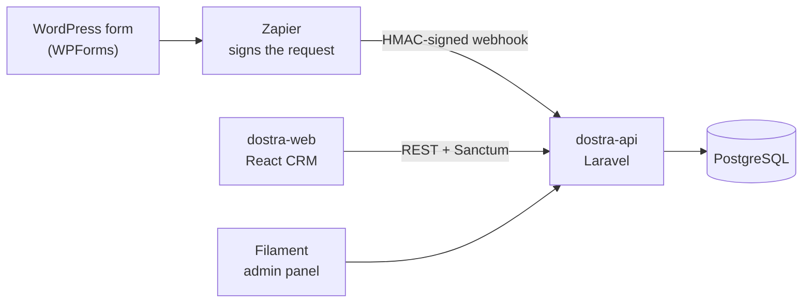
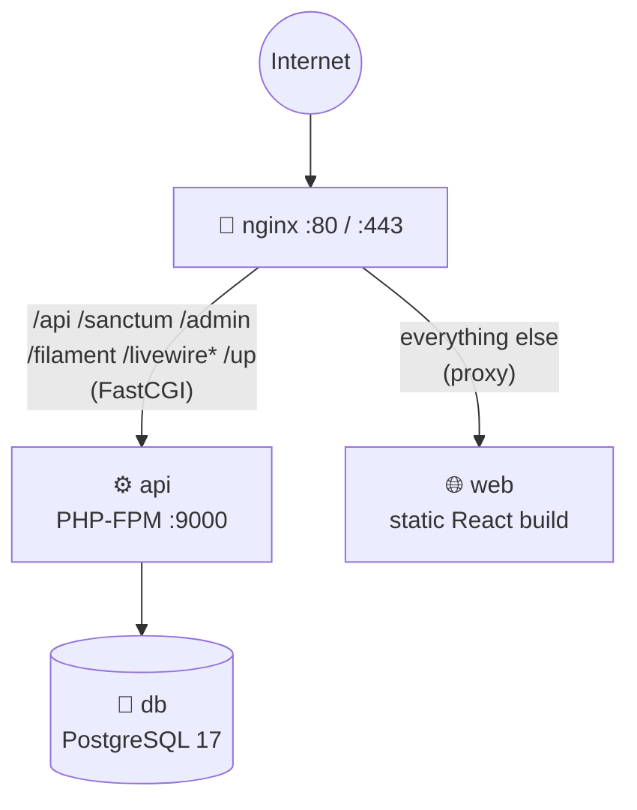
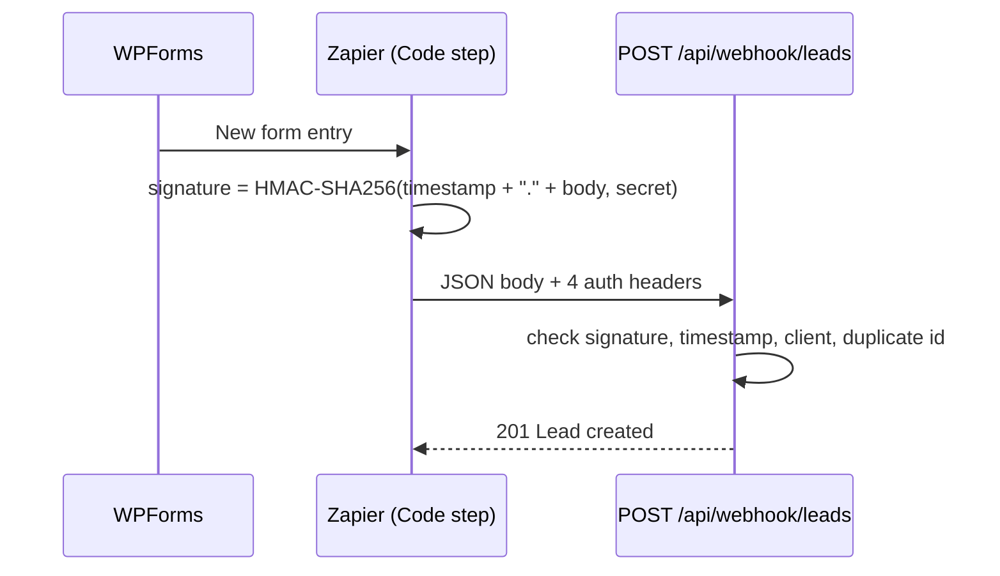

<div align="center">

<br/>

```
██████╗  ██████╗ ███████╗████████╗██████╗  █████╗
██╔══██╗██╔═══██╗██╔════╝╚══██╔══╝██╔══██╗██╔══██╗
██║  ██║██║   ██║███████╗   ██║   ██████╔╝███████║
██║  ██║██║   ██║╚════██║   ██║   ██╔══██╗██╔══██║
██████╔╝╚██████╔╝███████║   ██║   ██║  ██║██║  ██║
╚═════╝  ╚═════╝ ╚══════╝   ╚═╝   ╚═╝  ╚═╝╚═╝  ╚═╝
```

### **Deploy**

*Run the whole Dostra CRM stack with one command. Dev or production.*

<br/>

[](releases/v1.0.0/CHANGELOG.md)
[](https://www.docker.com/)
[](https://laravel.com/)
[](https://www.php.net/)
[](https://react.dev/)
[](https://www.typescriptlang.org/)
[](https://vitejs.dev/)
[](https://www.postgresql.org/)
[](https://nginx.org/)

<br/>

[What is Dostra?](#-what-is-dostra) ·
[Quick start](#-quick-start) ·
[Production](#-production-deployment) ·
[Zapier](#-zapier-integration) ·
[Releases](#-releases) ·
[Troubleshooting](#-troubleshooting)

</div>

---

## ✨ What is Dostra?

**Dostra is a lead-management CRM.** A visitor fills in a form on a client's WordPress site, and the lead lands in the CRM seconds later. Admins manage every client. Clients see only their own leads.

This repository is the **deployment and orchestration layer**. It holds no application logic. It wires the two application repos (Git submodules) together with Docker, Nginx and a set of scripts.



| Repo | Role | Stack |
|------|------|-------|
| [`dostra-api`](https://github.com/chetannagar/dostra-api) | Webhook ingestion, REST API, Filament admin panel | Laravel 13 · PHP 8.5 · Sanctum · Filament 5 · Pest |
| [`dostra-web`](https://github.com/chetannagar/dostra-web) | CRM dashboard for admins and clients | React 19 · Vite · TypeScript · Tailwind CSS |
| **`dostra-deploy`** *(this repo)* | Docker Compose, Nginx, env files, scripts, releases | Docker · Nginx · Bash |

---

## 🗂 Repository layout

```
dostra-deploy/
├── dostra-api/                 # 🔗 submodule: Laravel backend
├── dostra-web/                 # 🔗 submodule: React frontend
├── nginx/
│   ├── Dockerfile              # nginx + Filament static assets
│   └── nginx.conf              # production reverse-proxy routing
├── scripts/
│   ├── docker-deploy.sh        # dev: build + start
│   ├── docker-rollback.sh      # dev: stop
│   ├── run-all.sh              # dev without Docker
│   ├── docker-deploy-prod.sh   # prod: validate, build, start, wait for healthy
│   └── release.sh              # prepare / tag / show releases
├── releases/                   # one folder per release (changelog + pinned versions)
├── docs/
│   ├── DEPLOY.md               # full production guide
│   └── ZAPIER-INTEGRATION.md   # webhook + Zapier setup
├── docker-compose.yml          # development stack
├── docker-compose.prod.yml     # production stack
├── .env.example                # dev variables
└── .env.prod.example           # prod variables
```

---

## 🚀 Quick start

### Prerequisites

- **Docker** with Compose v2
- **Git**
- *(only for running without Docker)* PHP 8.5.12+, Composer, Node.js 22+

### 1. Clone with submodules

```bash
git clone --recurse-submodules <repo-url>
cd dostra-deploy
```

Already cloned without them?

```bash
git submodule update --init --recursive
```

### 2. Configure the environment

```bash
cp .env.example .env
cp dostra-api/.env.example dostra-api/.env
cp dostra-web/.env.example dostra-web/.env     # set VITE_API_BASE_URL
```

### 3. Start the stack

```bash
./scripts/docker-deploy.sh
```

| Service | URL |
|---------|-----|
| 🌐 Frontend (Vite, hot reload) | http://127.0.0.1:5173 |
| ⚙️ API (Laravel) | http://127.0.0.1:8000 |
| 🐘 PostgreSQL | `127.0.0.1:5432` |

### 4. Stop it

```bash
./scripts/docker-rollback.sh        # keeps volumes, so restarts are fast
docker compose down -v              # full reset, deletes the dev database too
```

> **Seed logins** (dev only): `admin@example.com` / `password` and `client@example.com` / `password`.

<details>
<summary><strong>🧑‍💻 Run without Docker</strong></summary>

<br/>

Needs PHP, Composer and Node already installed.

```bash
# First time
cd dostra-api
composer install
cp .env.example .env
php artisan key:generate
touch database/database.sqlite
php artisan migrate --seed

cd ../dostra-web
npm install
cp .env.example .env

# Every time, from the repo root
./scripts/run-all.sh      # runs `composer run dev` and `npm run dev` together
```

Local mode uses SQLite. The Docker dev stack uses PostgreSQL.

</details>

<details>
<summary><strong>⚙️ Dev environment variables</strong></summary>

<br/>

Set in the root `.env`. All have defaults.

| Variable | Default | Purpose |
|----------|---------|---------|
| `DOSTRA_API_PORT` | `8000` | Host port for the API |
| `DOSTRA_WEB_PORT` | `5173` | Host port for Vite |
| `DOSTRA_API_APP_ENV` / `_APP_DEBUG` / `_APP_URL` | `local` / `true` / `http://127.0.0.1:8000` | Laravel overrides |
| `DOSTRA_API_DB_*` | `pgsql`, host `db`, port `5432` | Database wiring for the API container |
| `DOSTRA_WEB_VITE_API_BASE_URL` | `http://127.0.0.1:8000/api` | API URL the **browser** uses, so it must be the host-mapped port, not the container name |

Named volumes (`dostra_api_vendor`, `dostra_web_node_modules`, `dostra_postgres_data`) keep dependencies and data inside Docker. Don't bind-mount over them.

</details>

---

## 🏭 Production deployment

Production runs four containers on one Docker network. **Only Nginx is exposed.**



| Container | Image | Role |
|-----------|-------|------|
| `dostra-nginx-prod` | `nginx:1.27-alpine` + Filament assets | Reverse proxy, the only public entry point |
| `dostra-api-prod` | `dostra-api/Dockerfile.prod` (PHP 8.5.12 FPM, non-root) | Laravel API and admin panel |
| `dostra-web-prod` | `dostra-web/Dockerfile.prod` | Pre-built React static files |
| `dostra-db-prod` | `postgres:17-alpine` | Database, persisted in `dostra_postgres_data_prod` |

### Deploy in 4 steps

```bash
# 1. On the server
git clone --recurse-submodules <repo-url> dostra-deploy && cd dostra-deploy

# 2. Create and fill in the env file
cp .env.prod.example .env.prod

# 3. Generate an APP_KEY (no local PHP needed)
docker run --rm php:8.5.12-cli php -r "echo 'base64:' . base64_encode(random_bytes(32)) . PHP_EOL;"

# 4. Ship it
./scripts/docker-deploy-prod.sh
```

The script is built to fail early and loudly. It:

1. ✅ checks `.env.prod` exists, has no `change_me` / `replace_with` / `yourdomain.com` placeholders, and has every required variable
2. 🔄 updates submodules
3. 🏗 builds images with `--pull --no-cache`
4. 🚀 starts everything with `up -d`
5. 🩺 waits up to 180 s for every service to report **healthy**. It exits with an error on `unhealthy`, `exited` or timeout.

The API container runs `optimize` and `migrate --isolated` before PHP-FPM starts, so **healthy means migrated and serving**.

### Required variables (`.env.prod`)

| Variable | Description |
|----------|-------------|
| `POSTGRES_DB` · `POSTGRES_USER` · `POSTGRES_PASSWORD` | Database credentials (shared by `db` and `api`). Use a strong password. |
| `APP_KEY` | Laravel encryption key. Generate once and don't rotate without a plan. |
| `APP_URL` | Public URL, e.g. `https://crm.example.com` |
| `VITE_API_BASE_URL` | Public API URL, e.g. `https://crm.example.com/api`. **Baked into the JS bundle at build time**, so changing it needs a rebuild. |

### First login

Production never seeds users. On a fresh database, create the first user with `php artisan tinker` inside the container. The `/admin` panel only admits the **`super_user`** role:

```bash
docker exec -it dostra-api-prod php artisan tinker
```

```php
App\Models\User::create(['name' => 'You', 'email' => 'you@example.com', 'password' => 'strong-password', 'role' => 'super_user']);
```

### Updating a running server

```bash
git pull
./scripts/docker-deploy-prod.sh     # rebuilds; migrations run automatically
```

### HTTPS

The SSL server block in [`nginx/nginx.conf`](nginx/nginx.conf) is ready but commented out.

- **Certbot / Let's Encrypt:** get certs, uncomment the `443` block and the HTTP→HTTPS redirect, mount the certs, uncomment `"443:443"` in `docker-compose.prod.yml`, redeploy.
- **Load balancer / CDN (Cloudflare, ALB...):** nothing to change. Keep Nginx on port 80.

Step-by-step instructions are in [`docs/DEPLOY.md`](docs/DEPLOY.md#ssl--https).

### Everyday commands

```bash
# add --env-file .env.prod to avoid "variable is not set" warnings
docker compose -f docker-compose.prod.yml ps                # status
docker compose -f docker-compose.prod.yml logs -f api       # follow one service
docker exec dostra-api-prod php artisan <command>           # run artisan
docker exec -it dostra-db-prod psql -U $POSTGRES_USER -d $POSTGRES_DB

# backup / restore
docker exec dostra-db-prod pg_dump -U $POSTGRES_USER $POSTGRES_DB > backup_$(date +%Y%m%d_%H%M%S).sql
cat backup.sql | docker exec -i dostra-db-prod psql -U $POSTGRES_USER -d $POSTGRES_DB

docker compose -f docker-compose.prod.yml down              # stop, keep data
docker compose -f docker-compose.prod.yml down -v           # ⚠️ stop AND delete the database
```

📖 Full guide: [`docs/DEPLOY.md`](docs/DEPLOY.md)

---

## 🔌 Zapier integration

Leads arrive through a **signed webhook**. Every client has its own `client_key` and `webhook_secret`, found in the admin panel under **Clients**. The secret is shown once, so copy it when it's created or rotated.



**Required headers**

| Header | Meaning |
|--------|---------|
| `X-Client-Key` | Which client the lead belongs to |
| `X-Webhook-Id` | Unique event id. Replays are deduplicated (`200`, no second lead). |
| `X-Webhook-Timestamp` | Unix seconds. Rejected if older than 5 minutes. |
| `X-Webhook-Signature` | Hex HMAC-SHA256 of `timestamp.rawBody` |

**Body** (all fields optional): `name`, `email` (must be valid if present), `message`.
**Rate limit:** 60 requests/min per client key.

**Setup in short:** create a Zap with the WPForms *New Form Entry* trigger, add a *Code by Zapier* (JavaScript) action, pass `webhook_url`, `client_key`, `webhook_secret`, `name`, `email`, `message` as inputs, and paste the signing snippet from the docs.

| Error | Usual cause |
|-------|-------------|
| `401 Invalid webhook signature` | Wrong or rotated secret, or body modified after signing |
| `401 Webhook timestamp is too old` | Clock skew or a replayed old event |
| `401 Invalid webhook client` | Wrong `client_key`, or client deactivated |
| `422` | `email` is not a valid address |
| Zapier "Execution exceeded 1 seconds" | Free/Starter plans cap Code steps at 1 s. The lead is usually created anyway. Upgrade, or keep the API warm. |

**Lost or leaked secret?** Admin panel → **Clients** → *Rotate Webhook Secret*. The old one dies immediately, so update the Zap.

📖 Full guide with the complete code snippet: [`docs/ZAPIER-INTEGRATION.md`](docs/ZAPIER-INTEGRATION.md)

---

## 🔐 Roles, auth and limits

| Topic | How it works |
|-------|--------------|
| **Roles** | `super_user` (also reaches the `/admin` panel), `admin` (sees everything in the CRM) and `client` (sees only assigned clients and their leads). Enforced with Sanctum, Policies and scoped queries. |
| **Auth** | Laravel Sanctum. The web app logs in via `POST /api/login`. |
| **Admin panel** | Filament at `/admin` for managing Clients, Users and Leads. |
| **Rate limits** | Login 5/min per email+IP · Webhook 60/min per client key · CRM API 120/min per user |
| **Data model** | `clients` → `leads` (1:many). `clients` ↔ `users` (many:many). |

---

## 📦 Releases

The whole stack has **one SemVer version**. Each release lives in `releases/vX.Y.Z/` and records:

- `VERSION`
- `components.json`: the exact `api` and `web` commits, plus PHP, Node, Postgres and Nginx versions
- `CHANGELOG.md`: human-written notes

**Current: [v1.0.0](releases/v1.0.0/CHANGELOG.md)** (2026-10-24). It includes the PHP 8.5.12 security upgrade, real health checks, the Filament admin panel reachable in production, and a fixed prod deploy script.

```bash
./scripts/release.sh prepare 1.1.0   # snapshot submodule commits + scaffold the changelog
# edit releases/v1.1.0/CHANGELOG.md, commit releases/
./scripts/release.sh tag 1.1.0       # annotated tag, verifies pinned commits match
git push --follow-tags
./scripts/release.sh show            # print the latest release's components
```

Bump the version whenever a submodule pointer moves, or compose, Nginx or the scripts change. Requires `jq`.

---

## 🔄 Working with submodules

The golden rule: **commit inside the submodule first, then update the pointer here.**

```bash
cd dostra-api
git add . && git commit -m "feat: ..." && git push
cd ..

git add dostra-api
git commit -m "chore: update dostra-api"
git push
```

Pull the latest from both:

```bash
git submodule update --remote --merge
```

`release.sh prepare` refuses to run if a submodule has uncommitted changes or an unpushed `HEAD`, so a release can always be rebuilt on another machine.

---

## 🩺 Troubleshooting

| Symptom | Check |
|---------|-------|
| Deploy script says placeholders remain | Search `.env.prod` for `change_me`, `replace_with`, `yourdomain.com` |
| `db` unhealthy | `docker logs dostra-db-prod`. Usually a wrong `POSTGRES_PASSWORD`, or an old volume made with different credentials. |
| `api` keeps restarting | `docker logs dostra-api-prod`. Check `APP_KEY`, the `DB_*` / `POSTGRES_*` match, and the migration output. |
| Blank frontend or API errors | `VITE_API_BASE_URL` is wrong. It's baked in at build time, so fix it and rebuild. |
| Nginx `502 Bad Gateway` | `api` isn't healthy yet. Run `docker compose -f docker-compose.prod.yml ps`. |
| `/admin` can't log in on a fresh DB | No user exists yet. See [First login](#first-login). |
| Dev: browser can't reach the API | `DOSTRA_WEB_VITE_API_BASE_URL` must use the host port, not `api:8000`. |
| Dev: stale or odd dependencies | `docker compose down -v`, then redeploy. |

---

## 🧭 Design principles

- **Deploy stays dumb.** Infrastructure only, with no business logic.
- **Independent services.** The API and the web app are versioned, built and tested on their own.
- **Fail fast.** Preflight checks, health checks and pinned versions catch problems before users do.
- **Reproducible.** Every release pins exact commits and runtime versions.

---

## 🗺 Roadmap

- [ ] CI/CD pipeline via GitHub Actions
- [ ] HTTPS out of the box
- [ ] Redis for cache and locks (needed for multiple API replicas)
- [ ] Horizontal scaling and load balancing
- [ ] Automated database backups

---

## 👤 Author

**Chetan Nagar**

## 📄 License

Internal use only. Add a licence file if this becomes public.

---

<div align="center">
<sub>Built with Docker · Laravel · React · ☕</sub>
</div>
