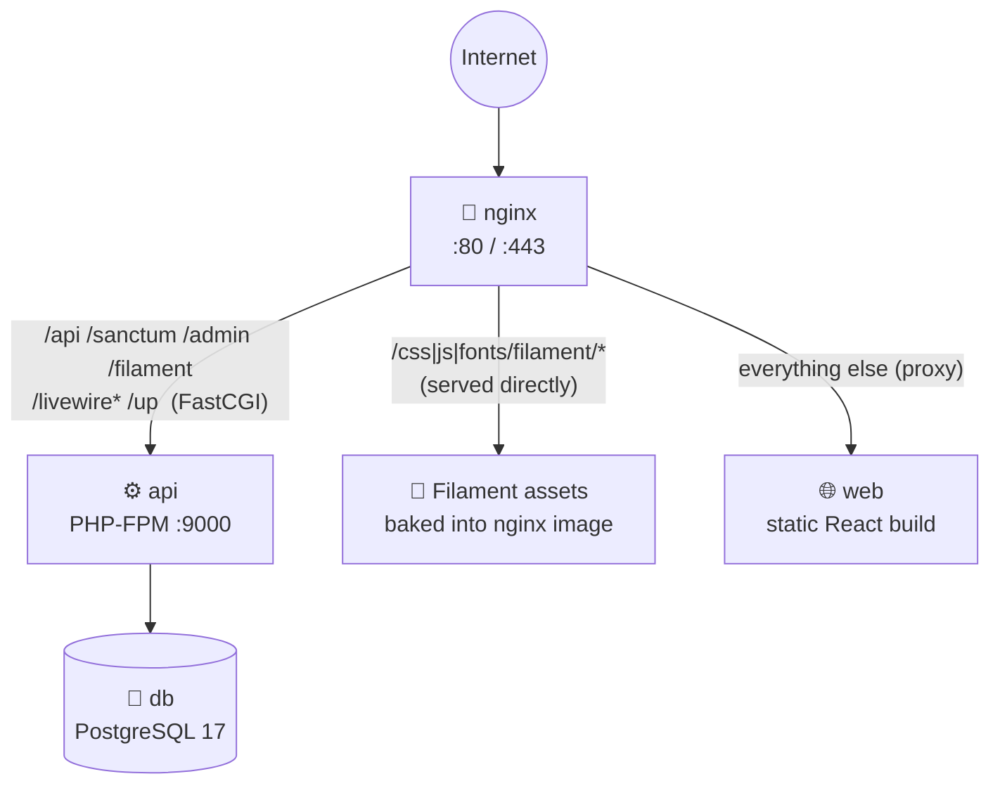

# 🚀 Deploying Dostra CRM to Production

A complete guide to running the Dostra CRM stack on a single server with Docker Compose.

**On this page:** [Architecture](#architecture) · [Prerequisites](#prerequisites) · [First-time setup](#first-time-setup) · [Create the first admin](#4-create-the-first-admin) · [Updating](#updating-a-running-server) · [Variables](#environment-variables-reference) · [HTTPS](#ssl--https) · [Commands](#useful-commands) · [Backups](#data--backups) · [Rollback](#rolling-back) · [Troubleshooting](#troubleshooting)

---

## Architecture



Four containers, one Docker network. **Only Nginx publishes a port to the host.**

| Container | Image | Role |
| --- | --- | --- |
| `dostra-nginx-prod` | `nginx:1.27-alpine` (built from `nginx/Dockerfile`) | Reverse proxy. Also serves Filament's static assets. |
| `dostra-api-prod` | Built from `dostra-api/Dockerfile.prod` (PHP 8.5.12 FPM, runs as non-root `www-data`) | Laravel API and Filament admin panel |
| `dostra-web-prod` | Built from `dostra-web/Dockerfile.prod` | Pre-built React static files |
| `dostra-db-prod` | `postgres:17-alpine` | Database, stored in volume `dostra_postgres_data_prod` |

**Startup order** is enforced by health checks: `db` → `api` → `web` → `nginx`.

| Service | Healthy when |
| --- | --- |
| `db` | `pg_isready` succeeds |
| `api` | PHP-FPM port 9000 is open. The entrypoint runs `optimize` and `migrate` first, so healthy means **migrated and serving**. |
| `web` | `GET /` returns 200 |
| `nginx` | `GET /up` works through the full Nginx → PHP-FPM → Laravel path |

---

## Prerequisites

On the production server:

- Docker Engine 24+ and Docker Compose v2
- Git
- At least 1 GB RAM and 10 GB disk
- A domain pointing at the server *(needed for HTTPS)*

```bash
docker --version
docker compose version
```

---

## First-time setup

### 1. Clone with submodules

```bash
git clone --recurse-submodules <repo-url> dostra-deploy
cd dostra-deploy
```

Already cloned without them?

```bash
git submodule update --init --recursive
```

### 2. Create the production env file

```bash
cp .env.prod.example .env.prod
```

Fill in every value:

```bash
# PostgreSQL: used by both the db and api containers
POSTGRES_DB=dostra
POSTGRES_USER=dostra
POSTGRES_PASSWORD=<strong-random-password>

# Laravel
APP_KEY=<base64 key, see below>
APP_URL=https://yourdomain.com

# Frontend: baked into the JS bundle at build time
VITE_API_BASE_URL=https://yourdomain.com/api
```

**Generate `APP_KEY`.** If you have no PHP locally, use Docker:

```bash
docker run --rm php:8.5.12-cli php -r "echo 'base64:' . base64_encode(random_bytes(32)) . PHP_EOL;"
```

> ⚠️ `.env.prod` holds secrets and must never be committed.

### 3. Run the deploy script

```bash
./scripts/docker-deploy-prod.sh
```

What it does, in order:

1. **Preflight.** Fails if `.env.prod` is missing, still has `change_me`, `replace_with` or `yourdomain.com`, or if any required variable is empty.
2. **Submodules.** Runs `git submodule update --init --recursive`, which checks out the **commits this repo points at**. It doesn't pull newer ones.
3. **Build.** `docker compose build --pull --no-cache`, using fresh base images and no layer cache.
4. **Start.** `docker compose up -d`.
5. **Wait.** Polls every service for up to **180 s**. Exits with an error and a logs hint if any service is `unhealthy`, `exited`, missing, or the timeout is hit.

### 4. Create the first admin

Production never seeds users, so a fresh database has nobody who can log in. Create the first user:

```bash
docker exec -it dostra-api-prod php artisan tinker
```

```php
App\Models\User::create([
    'name' => 'Your Name',
    'email' => 'you@example.com',
    'password' => 'a-strong-password',   // hashed automatically
    'role' => 'super_user',
]);
```

The role matters. The `/admin` panel only lets in **`super_user`**.

| Role | Can do |
| --- | --- |
| `super_user` | Everything, including the Filament admin panel at `/admin` |
| `admin` | Full CRM access through the web app (all clients and leads) |
| `client` | Only the clients assigned to them, and those clients' leads |

### 5. Check it works

```bash
curl -i http://<your-server>/up                      # 200 from Laravel
docker compose -f docker-compose.prod.yml --env-file .env.prod ps    # all "healthy"
```

Then open the app in a browser and log in at `/` (CRM) or `/admin` (admin panel).

---

## Updating a running server

```bash
cd dostra-deploy
git pull                            # new deploy-repo commits and submodule pointers
./scripts/docker-deploy-prod.sh     # rebuilds and restarts
```

- Which version of the API and web gets deployed is decided by the **submodule pointers** committed in this repo. The deploy script checks them out as they are.
- Database migrations run automatically when the API container starts.
- Rebuilding is slow because of `--no-cache`. If speed matters more than freshness, remove that flag in the script.

To see exactly what a given release contains:

```bash
./scripts/release.sh show          # latest release
./scripts/release.sh show 1.0.0
```

---

## Environment variables reference

Set in `.env.prod`. Docker Compose passes them to the containers.

| Variable | Required | Description |
| --- | :---: | --- |
| `POSTGRES_DB` | ✓ | Database name |
| `POSTGRES_USER` | ✓ | Database user |
| `POSTGRES_PASSWORD` | ✓ | Database password. Use a strong random value. |
| `APP_KEY` | ✓ | Laravel encryption key. Generate once; rotating it invalidates sessions and encrypted data. |
| `APP_URL` | ✓ | Full public URL, e.g. `https://yourdomain.com` |
| `VITE_API_BASE_URL` | ✓ | Public API URL baked into the frontend bundle at **build time**. Changing it needs a rebuild. |

Fixed in `docker-compose.prod.yml` (not in `.env.prod`):

| Setting | Value | Why |
| --- | --- | --- |
| `APP_ENV` / `APP_DEBUG` | `production` / `false` | |
| `CACHE_STORE` | `file` | `migrate --isolated` needs a cache lock, and the `database` cache table doesn't exist on the first deploy. File is fine for one API container; switch to Redis if you ever run more. |
| `SESSION_DRIVER` / `QUEUE_CONNECTION` | `database` | |
| `LOG_CHANNEL` / `LOG_LEVEL` | `stderr` / `error` | Read logs with `docker logs` |

To skip auto-migration (e.g. you run it as a separate deploy step), set `RUN_MIGRATIONS=false` on the `api` service.

---

## SSL / HTTPS

The HTTPS server block in `nginx/nginx.conf` is written but commented out.

### Option A: Certbot (Let's Encrypt)

```bash
# On the host
apt install certbot
certbot certonly --standalone -d yourdomain.com     # stop anything on port 80 first

# Certificates land in:
#   /etc/letsencrypt/live/yourdomain.com/fullchain.pem
#   /etc/letsencrypt/live/yourdomain.com/privkey.pem
```

Then:

1. In `nginx/nginx.conf`, uncomment the `server { listen 443 ssl ... }` block and paste the same `location` blocks into it.
2. Point `ssl_certificate` and `ssl_certificate_key` at `/etc/nginx/certs/fullchain.pem` and `/etc/nginx/certs/privkey.pem`.
3. Uncomment the HTTP → HTTPS redirect block.
4. In `docker-compose.prod.yml`, mount the certs and publish port 443:

   ```yaml
   ports:
     - "80:80"
     - "443:443"
   volumes:
     - ./nginx/nginx.conf:/etc/nginx/conf.d/default.conf:ro
     - /etc/letsencrypt/live/yourdomain.com:/etc/nginx/certs:ro
   ```

5. Set `APP_URL` and `VITE_API_BASE_URL` to `https://...` in `.env.prod`.
6. Redeploy.

Let's Encrypt certificates expire after 90 days. Set up `certbot renew` (cron or systemd timer) and reload Nginx afterwards:

```bash
docker compose -f docker-compose.prod.yml exec nginx nginx -s reload
```

> `/etc/letsencrypt/live/...` contains symlinks into `/etc/letsencrypt/archive/...`. If Nginx can't read the certs, mount `/etc/letsencrypt` itself instead.

### Option B: Load balancer or CDN

If Cloudflare, an AWS ALB or similar terminates SSL, **no Nginx changes are needed.** Keep it on port 80. Make sure the balancer forwards `X-Forwarded-Proto`, and see the note in `nginx/nginx.conf` about trusted proxies.

---

## Useful commands

> Tip: add `--env-file .env.prod` to any `docker compose` command below to avoid "variable is not set" warnings.

```bash
# Status
docker compose -f docker-compose.prod.yml ps

# Logs: all services, or one
docker compose -f docker-compose.prod.yml logs -f
docker compose -f docker-compose.prod.yml logs -f api

# Run a Laravel artisan command
docker exec dostra-api-prod php artisan <command>

# Database shell
docker exec -it dostra-db-prod psql -U $POSTGRES_USER -d $POSTGRES_DB

# Reload Nginx after editing nginx.conf (it's bind-mounted)
docker compose -f docker-compose.prod.yml exec nginx nginx -s reload

# Stop the stack (keeps the data volume)
docker compose -f docker-compose.prod.yml down

# ⚠️ Stop AND delete all data
docker compose -f docker-compose.prod.yml down -v
```

---

## Data & backups

Database data lives in the named volume `dostra_postgres_data_prod`. It survives restarts and redeploys. It does **not** survive `down -v`.

**Back up:**

```bash
docker exec dostra-db-prod pg_dump -U $POSTGRES_USER $POSTGRES_DB > backup_$(date +%Y%m%d_%H%M%S).sql
```

**Restore:**

```bash
cat backup.sql | docker exec -i dostra-db-prod psql -U $POSTGRES_USER -d $POSTGRES_DB
```

Run backups on a schedule (cron) and copy them off the server. Do a test restore at least once.

---

## Rolling back

Each release records the exact API and web commits in `releases/vX.Y.Z/components.json`.

```bash
git checkout v1.0.0                  # the deploy repo tag
git submodule update --init --recursive
./scripts/docker-deploy-prod.sh
```

> ⚠️ Migrations are not reversed automatically. If the newer release added migrations, take a backup first and check whether the older code works with the migrated schema.

---

## Troubleshooting

| Symptom | What to check |
| --- | --- |
| Script: "contains unfilled placeholder values" | Search `.env.prod` for `change_me`, `replace_with`, `yourdomain.com` |
| Script: "X is missing or empty" | The variable must be present as `NAME=value` with a non-empty value |
| Script: timed out waiting | `docker compose -f docker-compose.prod.yml logs` and read the failing service |
| **`db` unhealthy** | `docker logs dostra-db-prod`. Usually a bad `POSTGRES_PASSWORD`, or an old volume created with different credentials. The password is only read when the volume is first created. |
| **`api` unhealthy or restarting** | `docker logs dostra-api-prod`. Look for a wrong `APP_KEY`, a mismatch with the `POSTGRES_*` values, or a failing migration. |
| **Blank page or API errors in the browser** | `VITE_API_BASE_URL` is wrong. It's baked in at build time, so fix it and redeploy. |
| **Nginx 502 Bad Gateway** | `api` isn't healthy yet. Check `ps`. After a redeploy, Nginx re-resolves containers within about 10 s. |
| **`/admin` login rejected** | The user's role must be `super_user`. See [Create the first admin](#4-create-the-first-admin). |
| **Admin panel loads unstyled** | Filament assets are baked into the nginx image at build time. Redeploy so nginx is rebuilt from the current api image. |
| **Wrong client IP, or `http://` links on an HTTPS site** | Check that Nginx (or your balancer) sets the `X-Forwarded-*` headers. See `nginx/nginx.conf`. |
| **"Server error" right after the first deploy** | Confirm `docker exec dostra-api-prod php artisan migrate:status` shows all migrations as `Ran`. |
