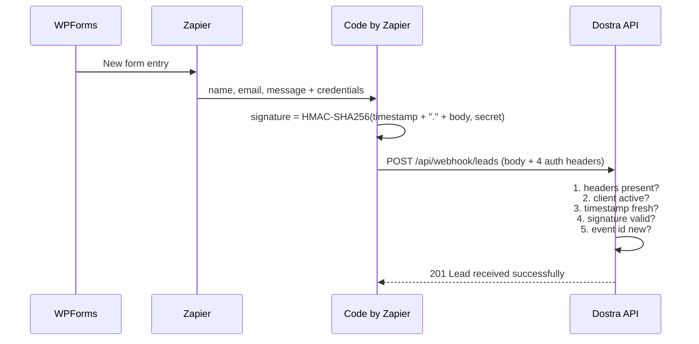

# 🔌 Zapier Integration

Connect WPForms submissions to the Dostra CRM through a **signed webhook**. Each form submission becomes a lead under the client you configure.

**On this page:** [How it works](#how-it-works) · [Step 1: credentials](#step-1--get-credentials-from-the-admin-panel) · [Step 2: create the Zap](#step-2--create-the-zap) · [Test it](#step-3--test-it) · [Endpoint reference](#webhook-endpoint-reference) · [Rotating the secret](#rotating-the-webhook-secret) · [Troubleshooting](#troubleshooting)

---

## How it works



Each client has a unique `client_key` and `webhook_secret`. The secret never travels over the wire. It only signs the request, so the API can verify the request came from someone who holds it.

---

## Step 1 · Get credentials from the admin panel

Log in to the Dostra admin panel (`/admin`) and open **Clients**, then the client you want to connect.

You need two values:

| Value | Example | Notes |
| --- | --- | --- |
| **Client Key** (`client_key`) | `wp_acme_corp` | Identifies the client. Not secret. |
| **Webhook Secret** (`webhook_secret`) | 64-character random string | **Shown once** after creation or rotation. Copy and store it safely. |

Lost the secret? Use **Clients → {client} → Rotate Webhook Secret** (see [Rotating the webhook secret](#rotating-the-webhook-secret)).

> Only super users can open the admin panel. If you're not one, ask an admin for the two values.
> The client must also be **active**. Inactive clients are rejected.

---

## Step 2 · Create the Zap

### Trigger: WPForms

1. Create a new Zap.
2. Trigger app: **WPForms**.
3. Trigger event: **New Form Entry**.
4. Connect your WPForms account.
5. Select the form.
6. Test the trigger to pull in a sample submission.

### Action: Code by Zapier

1. Add an action: **Code by Zapier**.
2. Action event: **Run JavaScript**.

#### Input data

Define these keys **exactly**:

| Key | Value |
| --- | --- |
| `webhook_url` | Your API URL, e.g. `https://yourdomain.com/api/webhook/leads` |
| `client_key` | The client key from Step 1 |
| `webhook_secret` | The webhook secret from Step 1 |
| `name` | Map from the WPForms name field |
| `email` | Map from the WPForms email field |
| `message` | Map from the WPForms message field |

#### Code

```javascript
const crypto = require('crypto');
const webhookUrl = inputData.webhook_url;
const clientKey = inputData.client_key;
const webhookSecret = inputData.webhook_secret;

const payloadObject = {
  name: inputData.name || null,
  email: inputData.email || null,
  message: inputData.message || null,
};

const rawBody = JSON.stringify(payloadObject);
const timestamp = Math.floor(Date.now() / 1000).toString();
const eventId = `evt_${Date.now()}_${Math.random().toString(36).slice(2, 10)}`;

const signature = crypto
  .createHmac('sha256', webhookSecret)
  .update(`${timestamp}.${rawBody}`)
  .digest('hex');

const controller = new AbortController();
const timeoutId = setTimeout(() => controller.abort(), 900);

try {
  const response = await fetch(webhookUrl, {
    method: 'POST',
    headers: {
      'Content-Type': 'application/json',
      'Accept': 'application/json',
      'X-Client-Key': clientKey,
      'X-Webhook-Id': eventId,
      'X-Webhook-Timestamp': timestamp,
      'X-Webhook-Signature': signature,
    },
    body: rawBody,
    signal: controller.signal,
  });

  clearTimeout(timeoutId);

  if (!response.ok) {
    throw new Error(`Webhook failed: ${response.status}`);
  }

  return { status: response.status, event_id: eventId };
} catch (error) {
  clearTimeout(timeoutId);
  throw error;
}
```

**Things worth knowing about this snippet:**

- The body is signed exactly as it is sent (`rawBody`). Don't re-serialize it between signing and sending.
- A **new `eventId` is generated on every run.** Deduplication therefore protects against the same *request* being delivered twice, but not against Zapier re-running the whole step, which creates a second lead. If duplicates matter, build `eventId` from something stable, such as the WPForms entry ID (map it in as an extra input, e.g. `` `wpforms_${inputData.entry_id}` ``).
- The 900 ms abort keeps the step under Zapier's 1-second limit on lower plans (see [Troubleshooting](#zapier-execution-exceeded-1-seconds)).

---

## Step 3 · Test it

1. In Zapier, test the Code step. A passing run returns `{ "status": 201, "event_id": "evt_..." }`.
2. Check the lead appears in the CRM under that client.
3. Test again with the *same* `event_id` (e.g. replay the request) and you should get a `200` and no new lead.
4. Turn the Zap on.

You can also test from a terminal. This signs and sends a request with `openssl`:

```bash
URL="https://yourdomain.com/api/webhook/leads"
KEY="wp_acme_corp"
SECRET="<webhook secret>"

BODY='{"name":"Jane Doe","email":"jane@example.com","message":"Hello"}'
TS=$(date +%s)
SIG=$(printf '%s' "$TS.$BODY" | openssl dgst -sha256 -hmac "$SECRET" | awk '{print $NF}')

curl -i "$URL" \
  -H "Content-Type: application/json" \
  -H "Accept: application/json" \
  -H "X-Client-Key: $KEY" \
  -H "X-Webhook-Id: manual_$(date +%s%N)" \
  -H "X-Webhook-Timestamp: $TS" \
  -H "X-Webhook-Signature: $SIG" \
  --data "$BODY"
```

---

## Webhook endpoint reference

| Property | Value |
| --- | --- |
| Endpoint | `POST /api/webhook/leads` |
| Content type | `application/json` |
| Rate limit | 60 requests/min per `X-Client-Key` |
| Idempotency | A repeated `X-Webhook-Id` returns the existing lead and creates nothing |
| Lead `source` | Set to `wpforms-zapier` |
| Stored data | The parsed fields, plus the full raw JSON payload |

### Required headers

| Header | Description |
| --- | --- |
| `X-Client-Key` | Client identifier |
| `X-Webhook-Id` | Unique event ID, used for idempotency |
| `X-Webhook-Timestamp` | Unix timestamp in seconds. Must be within **5 minutes** of server time (either direction). |
| `X-Webhook-Signature` | Hex HMAC-SHA256 digest |

### Payload fields

All fields are optional.

| Field | Type | Rules |
| --- | --- | --- |
| `name` | string | Max 255 characters |
| `email` | string | Valid email address, max 255 characters |
| `message` | string | Free text |

### Signature algorithm

```text
signed_payload = timestamp + "." + raw_json_body
signature      = hex( HMAC-SHA256(signed_payload, webhook_secret) )
```

Sign the **raw request body**, byte for byte. The API computes the signature over exactly what it receives.

### Responses

**`201 Created`** — new lead

```json
{
  "message": "Lead received successfully",
  "data": {
    "id": 42,
    "name": "Jane Doe",
    "email": "jane@example.com",
    "message": "Interested in your services",
    "source": "wpforms-zapier",
    "client": { },
    "created_at": "2026-04-22T10:00:00Z"
  }
}
```

**`200 OK`** — duplicate `X-Webhook-Id`, nothing created

```json
{
  "message": "Webhook event already processed.",
  "data": { }
}
```

**Errors**

| Status | Message | Cause |
| --- | --- | --- |
| `401` | `Missing webhook authentication headers.` | One of the four headers is absent |
| `401` | `Invalid webhook client.` | Unknown `client_key`, or the client is inactive |
| `401` | `Invalid webhook timestamp.` | Timestamp isn't whole digits |
| `401` | `Webhook timestamp is too old.` | More than 5 minutes off server time |
| `401` | `Invalid webhook signature.` | Wrong secret, or the body changed after signing |
| `422` | Validation error | Invalid `email`, or a field over its length limit |
| `429` | Too many requests | More than 60 requests/min for this client key |

---

## Rotating the webhook secret

Do this if the secret is leaked, or lost.

1. Admin panel → **Clients** → select the client → **Rotate Webhook Secret**.
2. **Copy the new secret immediately.** It's shown once.
3. Update `webhook_secret` in the Zapier Code step's input data.
4. Run a test to confirm it works.

The old secret stops working **immediately**, so leads sent between steps 1 and 3 will fail with `401`. Zapier shows those runs as errors, and you can replay them afterward.

---

## Troubleshooting

### `401 Invalid webhook signature`

- Check that `webhook_secret` in Zapier matches the current value (it changes on every rotation).
- Make sure no whitespace was copied along with the secret.
- Make sure the body isn't modified after signing, and that `Content-Type: application/json` is set.

### `401 Webhook timestamp is too old`

- The timestamp must be within 5 minutes of server time. The snippet generates a fresh one per run, so this suggests a replayed old request, or a server clock that's off. Check the API server's time.

### `401 Invalid webhook client`

- The `client_key` is wrong, or the client is deactivated in the admin panel.

### `401 Missing webhook authentication headers`

- A header is missing. If a proxy or firewall sits in front of the API, check that it doesn't strip `X-*` headers.

### `422 Unprocessable Content`

- `email` is present but not a valid address. Map the correct WPForms field, or leave `email` empty.

### `429 Too many requests`

- More than 60 requests a minute from one client key. Zapier retries later, but check for a looping Zap.

### Zapier: "Execution exceeded 1 seconds"

Code by Zapier has a 1-second limit on the Free and Starter plans, and 30 seconds on Professional and above. If the API's response time plus network latency exceeds that, Zapier reports an error **even though the lead may have been created**.

Options:

- Upgrade to Zapier Professional for the 30-second limit.
- Keep the API warm so requests aren't slowed by cold starts.
- Before replaying a failed run, check the CRM first. Replaying a run generates a new event ID, so it can create a duplicate lead (see the snippet notes in Step 2).

### Lead doesn't show up in the CRM

- Check the lead isn't under another client (the `client_key` decides that).
- Users with the `client` role only see leads for clients assigned to them.
- Look at the API logs: `docker logs dostra-api-prod`.
